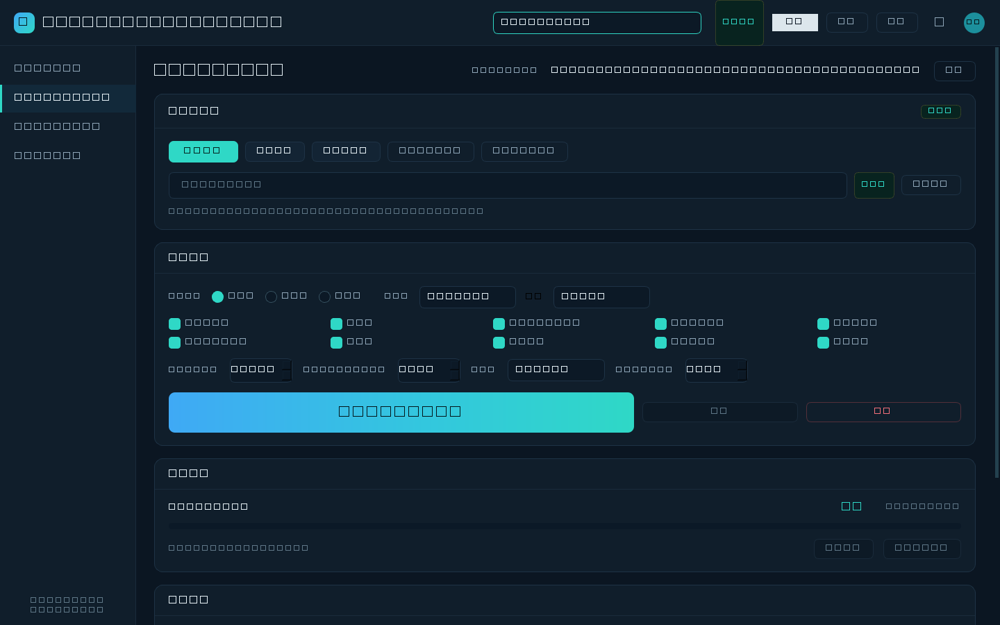

# OmicsOne · 一键组学分析平台

> 上传表达矩阵 → 点一个按钮 → 出一套带图的完整组学分析报告。
> Windows 单文件 exe，双击即用，**全部计算在本机完成，数据不出本机、不联网**。

- 版本：1.1.0
- 分析内容：质控与标准化、差异基因（DEG）、PCA、ORA 富集、GSEA、WGCNA
- 界面：PySide6（Qt 6）暗色科技风，左侧四项导航



---

## 一、它能做什么

| 功能 | 位置 | 说明 |
| --- | --- | --- |
| ① 上传数据集 | 「数据导入」页 /「一键」页顶部 | 支持 csv、tsv、txt、tab、xlsx、xls、csv.gz/.gz；自动识别分隔符、有无表头、基因在行还是在列 |
| ② 通过链接下载 | 「数据导入」页 →「链接下载」 | 直链即可；若链接是 zip / tar.gz / tgz，下载后自动解压并挑出数据文件 |
| ③ 结果存指定文件夹 | 「结果输出设置」页 /「一键」页右上「更改」 | 结果落在 `<输出目录>\OmicsOne_<项目名>_<时间戳>\`；下载缓存落在 `<输出目录>\downloads\` |
| ④ 一键组学分析 | 「一键全流程分析」页 | 质控 → 差异 → PCA → 富集 → GSEA → WGCNA，一次跑完 |
| ⑤ 只跑其中几项 | 「一键」页的勾选格子 | 取消不想跑的项即可，效果等同单项分析，结果落在同一个结果目录里 |

跑的过程中可以「暂停」（当前步骤跑完后停在检查点，点「继续」接着跑，暂停时长不计入 ETA）或「终止」（立即中断，已生成的图表和表格保留在输出目录）。所有过程信息同步进「运行日志」页，日志可清空、可导出 `txt`。

### 分组表：自动生成

差异分析 / 富集 / GSEA / WGCNA 需要样本分组。导入数据后点「自动生成分组表」，程序按样本名前缀推断组别（`control_1`、`ipf_H03` → `control`、`ipf`），导出一张两列 CSV 并立即载入。

个别样本名不合规范（如 `ipf_H03` 没有标准编号）不会让整份推断作废：会尝试按最长可匹配前缀归组，并把处理结果写进日志。推断不出来的样本会提示手工补一张分组表。

---

## 二、快速开始

### 用打包好的 exe

1. 双击 `OmicsOne.exe`（单文件首次启动要解压，5–10 秒属正常）。
2. 「数据导入」→ 用「本地上传文件 / 通过链接下载 / 选择文件夹」拿到表达矩阵。
3. 没有分组信息就点「自动生成分组表」，或点「分组表（可选）」手工指定已有分组表。
4. 「结果输出设置」→ 选输出文件夹，可顺手填个项目名（会进结果目录名）。
5. 回到「一键全流程分析」→ 勾好分析项 → 点「🚀 一键开始分析」。
6. 跑完点「打开报告」，或直接进输出目录看 `分析报告.html`。

### 从源码跑

```bash
python -m venv .venv
# Windows
.venv\Scripts\activate
# macOS / Linux
source .venv/bin/activate

pip install -r requirements.txt
python app/main.py
```

自测（不启动界面，构造数据跑完整链路并写 JSON 报告）：

```bash
python app/main.py --selftest selftest.json
```

命令行通道（适合批处理）：

```bash
python tools/cli.py examples/demo_expression_matrix.csv -o results --groups examples/demo_phenotype.csv
python tools/cli.py examples/demo_expression_matrix.csv -o results --steps qc deg pca
```

重新生成演示数据：

```bash
python tools/make_demo_data.py examples
```

---

## 三、输入数据要求

**表达矩阵**：一个标识列（基因名 / 蛋白名 / 代谢物名）+ 若干样本列。两种朝向都行：

```
gene,Control_1,Control_2,Treat_1,Treat_2      样本名,基因A,基因B
TP53,8.21,8.05,9.62,9.44                       Control_1,8.21,5.33
MYC,6.04,6.31,7.85,7.70            或          Control_2,8.05,5.41
```

自动处理：

- 识别分隔符（逗号 / 制表符 / 分号 / 空白）与是否缺表头；
- 判断基因在行还是在列，必要时转置；
- 重复基因名取均值合并，零方差基因剔除，缺失值补 0；
- 数值量级偏大（99 分位 > 50）时自动做 `log2(x+1)`，并在日志里写明；
- 样本名形如 `Control_1`、`Treat-2`、`WT 3` 时自动按前缀推断分组。

**分组表**（可选，但差异分析 / 富集 / GSEA / WGCNA 的模块-性状关联需要）：

```
sample,group
Control_1,Control
Control_2,Control
Treat_1,Treat
```

两列即可，列名随意（取前两列）。也可以给单列、以样本名为索引的表格。样本名必须和表达矩阵列名**完全一致**，否则会提示「分组表缺少 N 个样本的组别」。

比较组默认按分组两两配对（`A_vs_B`）。只想看指定的两组，就在「比较组」下拉里选 A 和 B。

---

## 四、输出目录结构

```
OmicsOne_肺癌队列A_20261020_181558\
├── 分析报告.html        自包含报告，图片 base64 内嵌，单独一个文件就能发人
├── 分析概览.md          一页纸摘要：数据集规模、参数、产出清单
├── summary.json         机器可读结果（显著基因数、PC1/PC2 解释率、模块数等）
├── run_log.txt          带时间戳的完整运行日志
├── figures\             全部图表 PNG（200 dpi，白底，可直接贴进 PPT）
└── tables\              全部结果表 CSV（UTF-8 BOM，Excel 双击不乱码）
```

图表清单（实际数量随比较组数量、基因集库数量变化）：

| 文件 | 内容 |
| --- | --- |
| `01_样本表达分布.png` | 各样本箱线图，看分布是否齐整 |
| `02_样本相关性.png` | 样本间相关性热图，查离群样本 |
| `03_标准化后表达分布.png` | 标准化后的箱线图 |
| `04_火山图_<A_vs_B>.png` | log2FC vs -log10(padj)，标注上调/下调 |
| `05_聚类热图_<A_vs_B>.png` | Top 差异基因 + 样本双向聚类，分组色带标在热图上方 |
| `06_主成分分析.png` | PC1/PC2 散点，按分组着色，95% 置信椭圆 |
| `07_富集条形图_*` / `08_富集气泡图_*` | ORA 结果 Top 15 |
| `09_GSEA条形图_*.png` / `10_GSEA曲线_*.png` | NES 排序 + Top3 通路的经典 GSEA 曲线 |
| `11_软阈值选择.png` | 无标度拓扑拟合 R² 随 β 变化 |
| `12_WGCNA聚类树.png` | 基因聚类树 + 模块颜色条 |
| `13_模块性状相关性.png` | 模块特征基因与分组的相关系数热图 |

表格清单：

| 文件 | 内容 |
| --- | --- |
| `01_sample_qc` | 每样本 median / mean / sd / IQR / min / max / 检出基因数 |
| `02_sample_correlation` | 样本间 Pearson 相关矩阵 |
| `03_normalized_expression` | 标准化后的表达矩阵 |
| `10_DEG_<A_vs_B>` | gene, log2FC, mean_A, mean_B, t, pvalue, padj, AveExpr, direction |
| `20_PCA_scores` / `_loadings` / `_variance` | 得分、载荷、解释方差 |
| `30_ORA_<A_vs_B>_<库简称>` | term, overlap, set_size, query_size, expected, fold_enrichment, pvalue, genes, padj；库简称 = `KEGG` / `GO_BP` / `GO_MF` / `GO_CC` / `Reactome` / `MSigDB` |
| `40_GSEA_<A_vs_B>` | term, set_size, ES, NES, pvalue, direction, leading_edge_size, padj |
| `41_GSEA_leading_edge` | 每通路的核心富集基因列表 |
| `50_WGCNA_power` | 每个候选 β 的 scale_free_R2 / 平均连通度 / 是否选中 |
| `51_WGCNA_modules` | 基因 → 模块归属 |
| `52_WGCNA_module_eigengenes` | 模块特征基因在各样本的取值 |
| `53_WGCNA_module_summary` | 每模块基因数、模块内平均连通度 |
| `54_WGCNA_module_trait` | 模块 vs 分组的相关系数与 p 值 |
| `55_WGCNA_hub_genes` | 每模块 Top30 连通度基因 |

> 表格的数字前缀是流水线顺序，不是版本号。中文文件名同样可以正常在 Excel 里打开。

---

## 五、方法说明（写论文 / 汇报时按这个口径写）

**预处理与质控。** 未检出值补 0，重复基因名取均值，零方差基因剔除。数据集数值明显未取对数时自动做 `log2(x+1)`。标准化可选分位数标准化（quantile normalization，默认，让各样本分布对齐）、中位数中心化或不做。质控输出每样本五数概括、检出基因数、样本间 Pearson 相关矩阵，相关系数低于 0.8 的样本会被标为疑似离群并写进日志。

**差异基因分析（DEG）。** limma 风格的线性模型 + 经验贝叶斯调节 t 检验（moderated t-test）。每个基因拟合组均值，用经验贝叶斯收缩残差方差，得到调节后的 t 统计量；`log2FC = mean(组A) - mean(组B)`。多重检验用 Benjamini–Hochberg 校正得 `padj`。默认阈值 `padj < 0.05` 且 `|log2FC| ≥ 1.0`，可在界面上改。

**主成分分析（PCA）。** 对标准化后的表达矩阵按基因中心化与缩放，做奇异值分解（SVD），输出样本得分、基因载荷与各主成分解释方差比例。散点图上按分组着色并画 95% 置信椭圆。

**富集分析（ORA）。** 超几何检验，查询集为该比较组的显著差异基因（上调下调合一起），**背景取本次实测到的全部基因**而不是全基因组注释，避免"未检出基因"造成假阳性。`fold_enrichment = 观测重叠数 / 期望重叠数`。p 值用 BH 校正。

**GSEA。** 预排序（preranked）版本。基因按 `log2FC` 降序排成全表，沿排序列表累积加权走位得到富集分数 ES；用**基因集置换**（默认 1000 次，可调 100–10000）生成零分布，标准化得 NES 与 p 值，再 BH 校正得 `padj`。显著阈值按惯例取 `FDR < 0.25`。核心富集基因（leading edge）单独出表，Top3 通路画经典 GSEA 曲线。

**WGCNA。** "软阈值选择 + 邻接矩阵 + TOM 相异度 + 层次聚类 + 分支切割 + 模块特征基因合并"的工程化 Python 实现，参数含义与 R 包 `WGCNA` 对齐：

- 邻接矩阵 `a_ij = ((1 + cor_ij) / 2)^β`，β 自动选第一个使无标度拓扑拟合 R² ≥ 0.8 的幂次（未达标则退回经验值）；
- 拓扑重叠矩阵 TOM，相异度 `1 - TOM`，平均连接层次聚类；
- 树切割得到初始模块，模块特征基因（第一主成分）相关性高于合并阈值的模块合并，过小模块并入相邻模块；
- 模块-性状相关用模块特征基因与分组 0/1 编码做 Pearson 相关；hub 基因按模块内连通度排序。

> **结果与 R 包 `WGCNA` 的 `dynamicTreeCut` 分支识别不完全等价**，模块编号与边界可能有差异，趋势与生物学解释应一致。写文章时建议注明"WGCNA 分析由自研 Python 实现完成，参数设置参照 R 包 WGCNA"。

**流水线依赖。** 富集与 GSEA 都以差异分析结果为输入。只勾这两项而没勾 DEG 时，程序会自动补算差异分析（日志会写明），但不输出 DEG 的图表，保证勾什么就出什么。

---

## 六、内置基因集库

六个 Enrichr GMT 库随仓库提供，离线可用，无需下载：

| 库名 | 说明 |
| --- | --- |
| `KEGG_2021_Human` | KEGG 2021 人类通路（富集与 GSEA 默认） |
| `GO_Biological_Process_2023` | GO 生物过程（ORA 默认第二个库） |
| `GO_Molecular_Function_2023` | GO 分子功能 |
| `GO_Cellular_Component_2023` | GO 细胞组分 |
| `Reactome_2022` | Reactome 2022 通路 |
| `MSigDB_Hallmark_2020` | MSigDB Hallmark 2020（50 条标志性基因集） |

这些都是**人类基因符号**库。做小鼠 / 大鼠数据要先自己把基因符号转成人类同源符号，否则富集结果为空或不可信；做植物、微生物数据则完全不适配。

---

## 七、常见问题

**双击没反应 / 启动慢。** 单文件 exe 首次启动要把内容解压到临时目录，5–10 秒正常。若杀毒软件拦截，把这个 exe 加白名单。

**提示"未识别到分组，跳过差异基因分析"。** 样本名里没有"组名 + 编号"这种结构。点「自动生成分组表」让程序按前缀推断；推不出来就补一张两列分组表再跑。

**富集结果是空的。** 三个原因按顺序排查：显著基因数少于 3 个（日志会提示跳过）；基因名不是人类符号（如 Ensembl ID、探针号）；选错了物种的库。

**GSEA 显著通路为 0 条。** `FDR<0.25` 是较严的阈值，小样本或弱效应常为 0，属正常。可以把置换次数调高、换个库，或看 `40_GSEA_*.csv` 里的原始 p 值。

**WGCNA 很慢。** 基因数默认上限 3000（界面可调）。TOM 是 O(n²) 内存与计算，上万基因会跑很久。真要做全基因组，先按方差或差异显著性预筛到 3000–5000。

**结果表打开乱码。** 表格是 UTF-8 带 BOM 的 CSV，Excel 双击正常。若用 WPS 或别的软件仍乱码，用"数据 → 从文本导入"并指定 UTF-8。

**能分析蛋白组 / 代谢组吗？** 质控、标准化、差异分析、PCA、火山图、热图都可以。富集、GSEA、WGCNA 依赖人类基因符号，蛋白组需先映射到基因符号，代谢组基本用不上（选"代谢组"会自动关掉这几项）。

---

## 八、打包

```bash
pip install pyinstaller
python -m PyInstaller --noconfirm OmicsOne.spec
```

产物在 `dist/OmicsOne.exe`（约 118 MB，单文件，目标机无需装 Python 或任何运行库）。打包前先关掉正在运行的 OmicsOne.exe，否则会 PermissionError。

打包后验证：

```bash
dist/OmicsOne.exe --selftest exe_selftest.json
```

`--selftest` 会真的构造数据、跑 GSEA 与全流程、生成报告，输出 `frozen / gmt_files / gsea_terms / figures / tables / report_bytes / errors` 字段。`frozen` 为 `true`、`errors` 为空且图表表格数量对得上，才算打包成功。

---

## 九、代码地图

```
app/
├── main.py             入口：主题、字体、异常兜底、--selftest
├── core/
│   ├── data_loader.py  格式识别、朝向判断、log2 检测、分组解析与自动分组表
│   ├── downloader.py   链接下载、压缩包解压（带路径穿越防护）
│   ├── qc.py           样本统计、相关性、离群检测、标准化
│   ├── deg.py          limma 风格调节 t 检验
│   ├── pca.py          标准化 + SVD
│   ├── enrichment.py   超几何 ORA
│   ├── gsea.py         预排序 GSEA + 置换检验
│   ├── wgcna.py        软阈值、TOM、聚类、模块-性状、hub 基因
│   ├── genesets.py     GMT 库加载
│   ├── plotting.py     全部图表（matplotlib Agg）
│   ├── pipeline.py     流水线编排、目录与文件命名、summary/日志
│   └── report.py       自包含 HTML 报告 + Markdown 概览
├── gui/
│   ├── main_window.py  四个页面、导航、状态机
│   ├── widgets.py      Card / Badge / StatChip / LogPanel
│   ├── workers.py      加载、下载、分析三个 QThread
│   └── theme.py        暗色主题 QSS + 资源路径
└── assets/             gmt 基因集库、logo
tools/
├── cli.py              命令行入口
├── make_demo_data.py   生成演示数据
└── screenshot.py       界面截图（调试用）
examples/               演示数据
```

---

## 十、边界与声明

- 本工具是**分析流程的自动化封装**，不替代统计与生物学层面的判断。显著阈值、库的选择、样本量与批次效应都需要使用者自己把关。
- WGCNA 为独立实现，与 R 包结果不完全等价（见第五节）。
- 内置基因集库版权归 KEGG、Gene Ontology Consortium、Reactome、MSigDB 各自所有，随 Enrichr 发布，仅供研究使用。
- 分析完全离线，不会上传任何数据，也不含任何遥测。

## 许可

Apache License 2.0，见 [LICENSE](LICENSE)。
